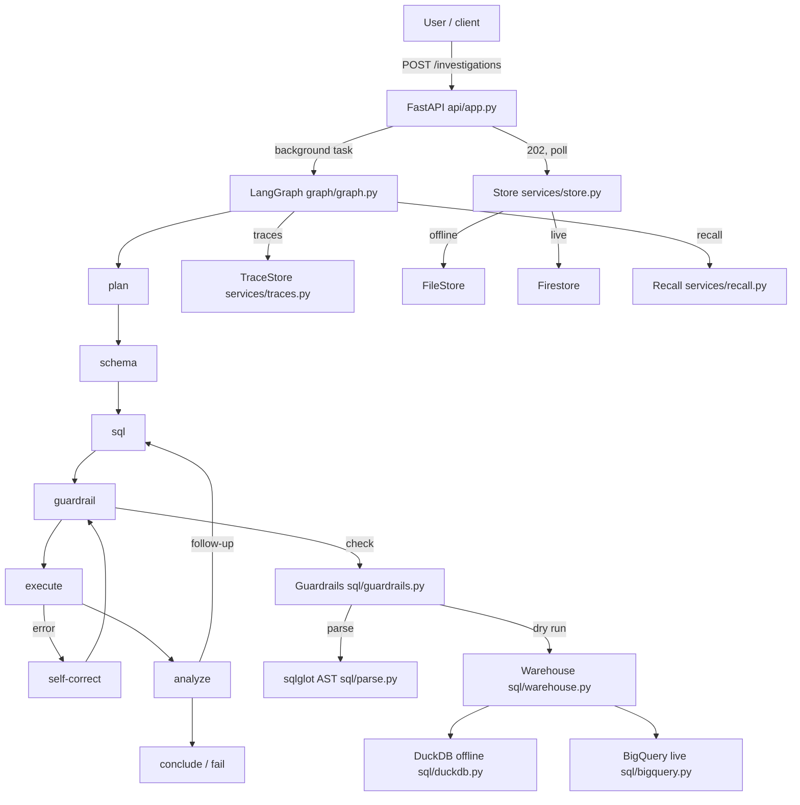

# AI Root Cause Analysis Agent on BigQuery

An agent that investigates automotive quality defects: it plans an
investigation, writes and runs safe BigQuery SQL, fixes its own
query errors, remembers past investigations, and explains its
findings with evidence. Every claim in the answer is backed by the
exact SQL and the rows it came from.

The warehouse is NHTSA complaints and recalls (public domain) plus
synthetic plant data with planted correlations — a brake spike at
one plant, a steering elevation at another, an airbag rise that is
not a plant story, a volume decoy, and a recall that explains part
of a spike. The agent runs fully offline (DuckDB + a deterministic
mock LLM) so the app, the tests, and CI need no GCP credentials and
no network; the live GCP deployment is Phase 8.

## At a glance

- **Stack:** Python 3.12, LangGraph, FastAPI, Pydantic v2, sqlglot,
  DuckDB (offline) / BigQuery (live), Firestore (live) / JSON files
  (offline).
- **Guardrails:** SQL is parsed (never regex-matched), only `SELECT`
  on allow-listed tables, a dry run before every query with a byte
  cap, a per-investigation query cap, and a daily byte cap. Every
  refusal is recorded with the rule that fired.
- **Answers:** findings, ranked hypotheses, the exact SQL and rows
  per claim, and a machine-readable verdict (`cause_type`,
  `entity`, `supporting_queries`). Numbers are checked against the
  rows by a deterministic validator; unmatched claims are marked
  "(unverified)". A count-based group comparison with no rate or
  volume check is flagged.
- **Eval:** 34 benchmark questions (frozen at version 1.0), split by
  planted pattern into a dev set and a held-out test set, graded
  exactly on the verdict with no LLM judging. Mock baseline on the
  held-out test set: 82.3% verdict accuracy.

## Architecture



The graph is `plan → schema → sql → guardrail → execute → analyze → conclude`, with self-correction on guardrail refusals and on execution errors (max 3 attempts), and one follow-up query when the analyze step finds the evidence insufficient. The plan's dry-run step is folded into the guardrail node: `Guardrails.check` already couples parsing, the dry run, and the caps, so splitting it would duplicate the gate.

The agent only ever writes BigQuery SQL. The dialect boundary is one module (`sql/dialect.py`), which transpiles BigQuery SQL to DuckDB for the offline warehouse. The LLM never sees complaint text when it writes SQL — the SQL prompt takes the question, the plan, and the schema only — and the answer builder never quotes free-text complaint content (rows are cited by their complaint id instead).

## Quickstart

Requires Python 3.12. On Windows, use `py -3.12` in place of `python3` and PowerShell's `.\backend\.venv\Scripts\Activate.ps1` in place of `source backend/.venv/bin/activate`.

```bash
git clone <repo>
cd rca-agent-bigquery

# Backend environment
python3 -m venv backend/.venv
backend/.venv/bin/pip install -e "backend[dev]"

# Build the offline warehouse from the committed sample CSVs (no download, ~1 second)
backend/.venv/bin/python scripts/seed_offline.py --from-sample

# Run the API
backend/.venv/bin/python scripts/run_api.py
```

Then, in another shell:

```bash
curl -X POST http://127.0.0.1:8000/investigations \
  -H "Content-Type: application/json" \
  -d '{"question": "Why did brake complaints spike for the 2021 F-150?"}'
# -> {"investigation_id": "...", "status": "running"}
curl http://127.0.0.1:8000/investigations/<id>
curl http://127.0.0.1:8000/investigations
```

The API stores investigations in `data/api-store/` and traces in `data/traces.duckdb` (both gitignored). To rebuild the full warehouse from the NHTSA downloads instead of the samples, run `backend/.venv/bin/python scripts/seed_offline.py` (about 3 minutes; it downloads the flat files, verifies the planted patterns, and writes `data/raw/DOWNLOAD.md`).

### Checks

From `backend/`:

```bash
.venv/bin/ruff format --check src tests ../data ../scripts
.venv/bin/ruff check src tests ../data ../scripts
.venv/bin/mypy src ../data ../scripts tests
.venv/bin/pytest -q
```

The mypy command must include `src/`: an earlier version of it did not, which let imports resolve silently to `Any` and hid 45 real type errors. CI runs the same commands (see `.github/workflows/ci.yml`).

### Eval

```bash
backend/.venv/bin/python eval/run.py --set test   # held-out set
backend/.venv/bin/python eval/run.py --set dev    # dev set
backend/.venv/bin/python eval/run.py --set all    # both
```

Reports land in `eval/results/` as `<date>-<set>.json` and `.md`. The benchmark is frozen at version 1.0 (`eval/benchmark.json`); changes need a new version and a re-run of the baseline. See `eval/README.md` for the metrics and how to read them.

## GCP setup

Phase 8 is the live deployment; the Terraform is written and validated now, and it is not applied yet. See `infra/terraform/README.md` for the full instructions. In short:

1. Create a GCP project and enable billing.
2. Set `project_id` and `run_invoker_email` in `terraform.tfvars` (not committed).
3. `terraform init && terraform plan && terraform apply` from `infra/terraform/`.

Terraform creates the BigQuery datasets (`rca_agent`, location US, for the warehouse; `rca_ops`, location US, for the traces table only) and their tables, the runner and deployer service accounts, the Artifact Registry repository (`rca-agent`), the Firestore database (`rca-agent`, Native mode), and the Cloud Run service (`rca-agent`). It creates no secrets: Vertex AI, BigQuery, and Firestore all use Application Default Credentials / workload identity. The runner service account can call Vertex AI (`aiplatform.user`, project-scoped — the least-privilege role for invoking a model), run BigQuery jobs, read only the `rca_agent` dataset, and write only the traces table in `rca_ops`. Two independent layers prevent any write to the queried data: the SQL guardrail (the agent's queries are allow-listed to `rca_agent` tables only, and the traces table is not in the allow-list) and IAM (the runner has only `dataViewer` on `rca_agent`). The container image is built from `backend/` and pushed to the Artifact Registry repository — see `infra/terraform/README.md` for the Cloud Build and local docker build/push commands.

**Cloud Run settings (the ones that matter):** the service runs with CPU always allocated (`cpu_idle = false`, instance-based billing), min instances 0, max instances 1, a 60-second request timeout, and one request at a time per instance. The reason is that investigations run as FastAPI background tasks after the 202 response, and under the default request-based billing Cloud Run throttles CPU to near zero after the response, so the background work would stall. The trade-off is that instance-based billing charges for every second an instance exists, which is why min instances is 0 (no idle cost) and max instances is 1 (one instance at a time, capping cost and keeping the per-instance state consistent). The residual risk is that an idle instance is still stopped and a background investigation can be killed; the startup recovery marks it failed instead of stuck. For a production service the right answer would be min instances 1 or a Cloud Tasks worker queue. Full reasoning: `docs/gcp-resources.md`.

## Guardrails

The guardrails are code, not prompts. A query is refused unless it passes, in order: the per-investigation query cap, sqlglot parsing (unparsable SQL is refused with rule `parse-error`), a single `SELECT`/`UNION` on allow-listed `rca_agent` tables only (unqualified tables are refused — a table must be written as `dataset.table`), the dry run, the per-query byte cap, and the daily byte cap. The verdict — allowed or refused, the reason, and the rule that fired — is a structured object recorded with every attempt.

Refused, each with a named rule: scripting (`DECLARE`, `BEGIN...END`, multi-statement), `CREATE TEMP FUNCTION` (including JavaScript UDFs), `EXPORT DATA`, `CALL`, DML/DDL, wildcard tables, `INFORMATION_SCHEMA` and other system views, cross-project and cross-dataset references, `FOR SYSTEM_TIME AS OF`, `EXTERNAL_QUERY`, ML/AI and remote functions (their cost is not visible in dry-run bytes), comment and case tricks, and CTEs, subqueries, and `UNION`s hiding a disallowed table. The executed SQL is always the serialized, checked AST after LIMIT rewriting — never the original string.

**LIMIT protects result size, not cost.** BigQuery bills bytes scanned, so a `LIMIT 10` query over a huge table is still expensive. The dry-run byte cap is the real cost control, and a LIMIT-ed query over the byte cap is still refused (there is a test proving it).

**Defense in depth.** The read-only, dataset-scoped service account is the real security boundary; the sqlglot checks are a first-line filter. The parser stops the agent from *trying* a disallowed query; the account stops it from *succeeding* even if the parser and the engine ever disagree about what a query means.

## Eval results (mock baseline, benchmark v1.0)

The benchmark is 34 questions: 17 dev, 17 held out. The mock is a deterministic stand-in whose canned answers are written for the benchmark's patterns, so its score is a harness smoke test and an upper bound on the graph's mechanics — not a prediction of a real model's score (that is Phase 8).

Held-out test set (mock):

| Metric | Value |
|---|---|
| Verdict accuracy | 82.3% (14/17) |
| Verdict accuracy, non-none verdicts | 78.6% (11/14) |
| False-discovery rate (negative controls) | 0.0% |
| First-pass SQL success | 100.0% |
| Self-correction recovery | 100.0% (vacuous — no refusals in the test set) |
| Unverified-claim rate | 0.0% (0 claims) |
| Unverified verdicts | 4 (23.5%) — T01, T03, T05, T06 (all P1) |
| Rate-rule warnings | 1 (T15, a known false positive — see below) |
| Guardrail block rate (adversarial, 33 queries) | 100.0% (0 rule mismatches) |
| Cost per investigation | $0.00 |
| Latency median / p95 | 280 ms / 491 ms |

Per pattern (test set): P1 50.0% (3/6), P3 100.0% (5/5), P5 100.0% (2/2), negative controls 100.0% (2/2), recall lookups 100.0% (2/2). The P1 misses are the mock's known gaps: it cannot drill down to a line (T03) and its brake verdict is fixed at the supplier, so it misses the two location questions (T05, T06). Dev set: 100.0% (17/17), 0 unverified verdicts.

The unverified verdicts are a separate signal from accuracy: a verdict can be right but ungrounded. T01's verdict (supplier/acme-brakes) is correct, but its only supporting query groups by plant, so no supporting row contains the supplier — the grounding check marks it "(unverified)". That is the smoke-test bug the check was built for: the agent claimed a supplier cause without supplier evidence.

The test set has about five independent patterns, so the overall accuracy is coarse: the questions inside one pattern test the same underlying effect, and missing that effect costs several questions at once. Read the per-pattern numbers first. The recall questions are mostly lookups (can the agent find a campaign and report its coverage), not root-cause analysis.

The one rate-rule warning (T15, the recall-share question) is a known false positive: its counts split covered from uncovered complaints by year, which is a coverage split, not a defect comparison — the rule is a heuristic and cannot tell those apart.

## Data

- **NHTSA ODI flat files** (public domain, U.S. Government work):
  complaints (`FLAT_CMPL.zip`, 2,264,318 rows) and recalls
  (`FLAT_RCL_POST_2010.zip`, 247,176 rows), downloaded from the
  `static.nhtsa.gov` mirror (the canonical `www-odi` host is
  unreachable from the sandbox). Field layouts at
  `static.nhtsa.gov/odi/ffdd/cmpl/CMPL.txt` and `.../rcl/RCL.txt`.
- **Scope:** FORD F-150 + HONDA PILOT, model years 2019–2021 (the
  top two makes by complaint volume). The offline warehouse holds
  7,108 real complaints, 8,706 synthetic complaints, 841 recalls,
  and 576 build batches.
- **Synthetic plant data:** fictional plants (Riverside, Lakeside,
  Summit, Harborview), lines, and suppliers, generated with seed 42.
  Real complaint rows carry no plant or VIN information, so
  plant-level findings can only come from synthetic rows — every
  complaint row carries `is_synthetic`, and answers label synthetic
  evidence "(synthetic)". **Plant-level findings are synthetic by
  design.** See `docs/data-plan.md` for exactly how the synthetic
  assignments are generated and joined to the real data.
- **Planted correlations:** P1 brake/Riverside/Acme (2021), P2
  steering/Lakeside (2019), P3 airbag (2020, no plant), P4 volume
  decoy (Honda Pilot production doubled, rate flat), P5 recall
  (26V104000 covers the 2021 F-150 brake complaints).
- **PII:** the loader drops identifying columns (VIN, operator name,
  dealer name/phone/city) and the sample drops rows whose complaint
  text contains a phone number or email, and redacts 17-character
  and partial VINs and full-form street addresses in place
  (35 rows scrubbed in the committed sample). See
  `data/schemas/README.md` for the full handling and its limits
  (addresses without a ZIP are not caught).

## Limitations

- The live BigQuery warehouse, the Vertex AI model, and the
  Terraform deployment are not wired yet (Phase 8). The offline
  mode (DuckDB + mock LLM) is what runs today, and the mock's
  baseline is not a prediction of a real model's score.
- The Vertex AI model id and prices are not chosen: they are verified
  against Google's own model list and pricing page in Phase 8, and
  no spend happens before approval.
- The current injection test proves the plumbing (evidence
  delimiters, the SQL prompt never sees complaint text, the answer
  never quotes free text). Resistance of a real model is measured in
  Phase 8.
- The claim validator checks numbers against row values and column
  sums; a derived number that is neither (a percentage, a ratio) is
  flagged as unverified.
- The daily byte ledger's Firestore increment is read-then-write, so
  two concurrent investigations can both pass the cap check. The fix
  is a Firestore transaction (a Phase 8 item — it needs the library
  and an emulator to test against).
- The `FirestoreStore` and `BigQueryTraceStore` are written and
  tested against fake clients; their first real GCP write is Phase 8.
- The Cloud Run scale-to-zero risk (see GCP setup above) and the
  `cpu_idle` trade-off are accepted for this demo.
- The benchmark's P3 (fleet-wide rise) and negative-control questions
  both concern "no localized cause", but they grade differently:
  P3 expects `fleet_wide`, a negative control expects `none`.
- The `traces` BigQuery table's `created_at` is a TIMESTAMP; the
  trace store writes an RFC 3339 string, which BigQuery accepts.
